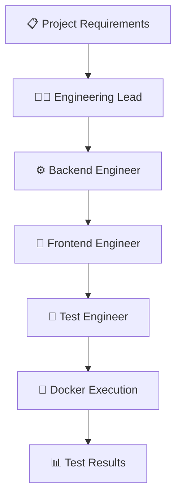

# 📈 Multi-Agent Stock Picker

**An AI-powered development team that builds, integrates, and tests a stock portfolio management application.**

What if software development could be handled by a team of AI agents, each responsible for a different part of the application?

That's the idea behind this project.

Built with **CrewAI and Google Gemini**, this project brings together specialized AI agents that collaborate to develop a stock portfolio management system — from backend APIs and frontend interfaces to automated testing and code execution.

Instead of asking one AI agent to do everything, I designed a hierarchical workflow where each agent has a specific responsibility and works with the output of other agents.

---

## ✨ What Does It Do?

The project has two parts:

**1. Multi-Agent Development System**

A CrewAI-powered team that:
- Coordinates development through an Engineering Lead.
- Builds backend APIs and business logic.
- Develops the frontend and connects it to the backend.
- Generates automated tests and checks application behavior.
- Executes generated Python code inside Docker.

**2. Stock Portfolio Management Application**

The application developed by the agents allows users to:
- Create an account and manage funds.
- Deposit and withdraw money.
- Buy and sell shares.
- Track stock holdings and available balance.
- View portfolio value and profit/loss.
- Review transaction history.

> **A quick note:** This is a portfolio management simulation, not a stock prediction system. It uses fixed test prices for AAPL, TSLA, and GOOGL rather than live market data.

---

## 🧠 Meet the AI Development Team

Each agent has a clearly defined role, just like a software engineering team.

| Agent | What it does |
|---|---|
| 🧑‍💼 Engineering Lead | Coordinates the team, delegates work, and oversees development. |
| ⚙️ Backend Engineer | Builds FastAPI endpoints, database models, and business logic. |
| 🎨 Frontend Engineer | Creates the Streamlit interface and integrates backend APIs. |
| 🧪 Test Engineer | Writes pytest tests, executes them, and reports failures. |

The Engineering Lead uses CrewAI's hierarchical process to coordinate the development workflow.

### How the Agents Work Together



The backend is developed first, allowing the frontend agent to work with its output. The testing agent then validates the generated application.

---

## 🏗️ Architecture & Tech Stack

I used different technologies for different responsibilities:

| Component | Technology |
|---|---|
| Agent orchestration | CrewAI |
| LLM | Google Gemini |
| Backend | FastAPI |
| Frontend | Streamlit |
| Database | SQLite |
| ORM | SQLAlchemy |
| Automated testing | Pytest |
| Code execution | Docker |
| Package management | uv |
| Language | Python |

### Custom Tools

To let agents interact with the project workspace and execute code, I built custom CrewAI tools.

- **FileReaderTool** — Reads existing project files so agents can inspect code.
- **FileWriterTool** — Creates and updates generated application files.
- **StockPriceTool** — Retrieves fixed prices for supported stock symbols.
- **DockerExecutorTool** — Runs Python commands and tests inside a Docker container.

### Why Docker?

Generated code should not be executed directly on the host machine.

I used Docker to run the code in a container with restrictions such as:
- Limited CPU and memory.
- Disabled network access.
- Read-only container filesystem.
- Execution timeouts.
- Dropped Linux capabilities.

These measures provide a baseline level of isolation, although they are not a complete security sandbox.

---

## 📂 Project Structure

```text
stock_picker/
│
├── docker/
│   └── Dockerfile
│
├── knowledge/
│
├── src/
│   └── stock_picker/
│       ├── config/
│       │   ├── agents.yaml
│       │   └── tasks.yaml
│       │
│       ├── tools/
│       │   ├── docker_executor.py
│       │   ├── file_reader.py
│       │   ├── file_writer.py
│       │   ├── stock_price_tool.py
│       │   └── stock_prices.py
│       │
│       ├── crew.py
│       └── main.py
│
├── workspace/
│   ├── backend/
│   ├── frontend/
│   ├── tests/
│   └── ...
│
├── AGENTS.md
├── README.md
├── pyproject.toml
└── uv.lock
```

---

## 🚀 Getting Started

Want to run the project locally? Follow these steps.

### Prerequisites

- Python 3.11 or later
- Docker Desktop
- uv
- Google Gemini API key

### 1. Clone the repository

```bash
git clone https://github.com/YOUR_USERNAME/stock-picker.git
cd stock-picker
```

### 2. Install dependencies

```bash
uv sync
```

### 3. Configure your API key

Create a `.env` file in the project root:

```env
GEMINI_API_KEY=your_gemini_api_key
```

### 4. Build the Docker image

Make sure Docker Desktop is running, then execute:

```bash
docker build -t stock-picker-runner:latest -f docker/Dockerfile docker
```

### 5. Start the multi-agent system

```bash
uv run crewai run
```

The CrewAI workflow will start and the configured agents will begin working on the application.

---

## 💻 Running the Generated Application

Once the application files have been generated, open two terminals from the project root.

**Terminal 1 — Backend**

```bash
uv run uvicorn backend.main:app --app-dir workspace --reload
```

FastAPI documentation:

http://127.0.0.1:8000/docs

**Terminal 2 — Frontend**

```bash
uv run streamlit run workspace/frontend/app.py
```

Open the application:

http://localhost:8501

---

## 📚 What I Learned

This project gave me hands-on experience with several important AI engineering concepts:

- Building multi-agent systems instead of relying on a single agent.
- Designing hierarchical orchestration and task delegation.
- Creating custom tools that allow agents to interact with files and external execution environments.
- Passing context between dependent tasks.
- Generating application code programmatically.
- Integrating a FastAPI backend with a Streamlit frontend.
- Using Docker to isolate generated code execution.
- Automating application testing with pytest.

One of the most interesting parts was figuring out how to make agents work together reliably — especially when one agent's output becomes another agent's input.

---

## 🔮 What's Next?

There is plenty of room to improve this project. Some ideas I'm exploring:

- Integrating live stock market data.
- Improving automated debugging and code correction.
- Adding authentication and user-specific portfolios.
- Expanding test coverage with integration tests.
- Improving deployment, monitoring, and reliability.

---

**Built with Python, CrewAI, Gemini, and a lot of experimentation.** 🚀
